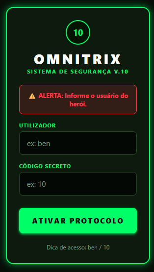
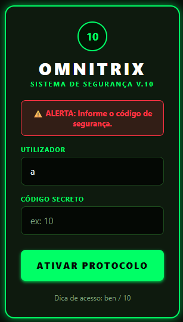
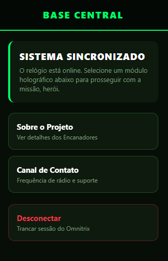
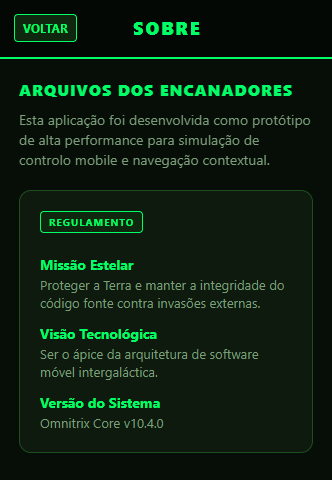
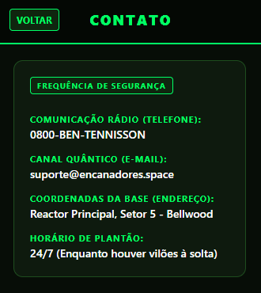

# Omnitrix App

## Sobre o projeto

O Omnitrix App é um aplicativo inspirado no desenho Ben 10, desenvolvido para colocar em prática alguns conceitos de programação de aplicativos. A ideia foi criar uma interface simples, com cores inspiradas no Omnitrix, utilizando principalmente verde e preto.

O aplicativo possui uma tela de login e, depois de entrar, o usuário pode acessar a tela inicial, consultar as informações sobre o projeto e visualizar a área de contato. Também é possível sair da conta e voltar para a tela de login.

## Como acessar

Para testar o aplicativo, utilize os seguintes dados na tela de login:

- Usuário: `ben`
- Senha: `10`

Esses dados são apenas para demonstração.

## Tecnologias utilizadas

O projeto foi desenvolvido utilizando React Native e Expo, com JavaScript e TypeScript em partes da estrutura do aplicativo.

## Como executar

Para abrir o projeto no computador, é necessário ter o Node.js instalado.

Primeiro, abra o terminal na pasta do projeto e execute:

```bash
npm install
```

Depois, inicie o aplicativo com o comando:

```bash
npx expo start
```

Após iniciar, siga as instruções exibidas no terminal para abrir o aplicativo no celular pelo Expo Go ou em um emulador compatível.

## Organização dos arquivos

- `App.js`: estrutura principal do aplicativo original.
- `Login.js`: tela de login.
- `Navegacao.js`: controle da navegação entre as telas.
- `Toolbar.js`: barra superior da interface.
- `styles.js`: estilos utilizados nas telas.
- `src/app/index.tsx`: ponto de entrada da interface na estrutura do Expo Router.

## Objetivo

O objetivo do projeto é praticar a criação de interfaces, a organização dos componentes e a navegação entre telas em um aplicativo mobile, usando o universo de Ben 10 como tema.

### Telas

### Tela inicial







### Tela central



### Tela Sobre



### Tela de Contato


